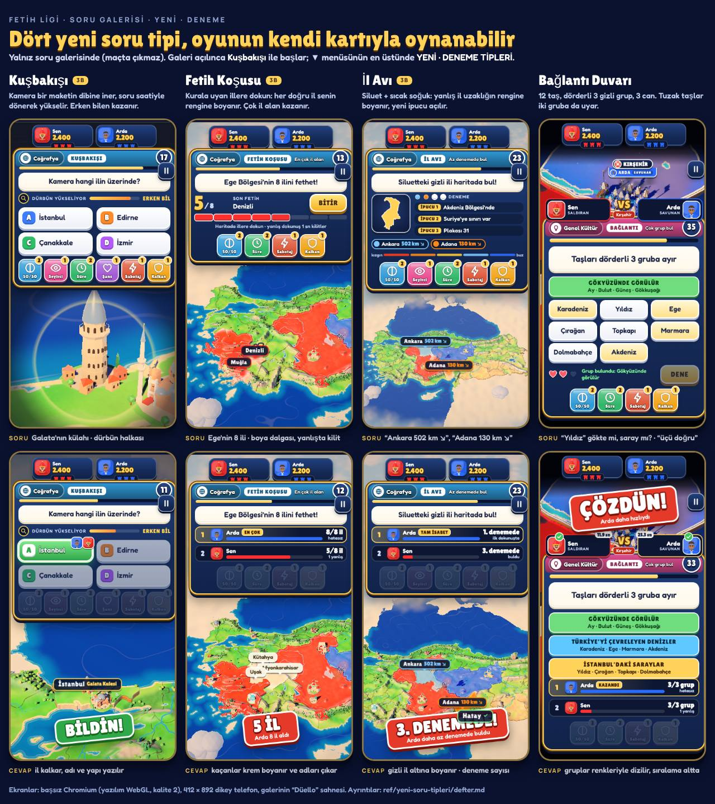

# Yeni soru tipleri defteri

29 Ekim gecesi. İstek: "Oyunda olmayan, çok eğlenceli ve zekice yapılmış yeni soru tipleri bul. İşaretleme değil, başka şeyler.
Beni şaşırt, rakiplerin önüne geçelim."

**Kısaca:** rakiplerin ve TV yarışmalarının mekanikleri incelendi, **18 yeni tip** önerildi ve sıralandı. İlk dördü
**oynanabilir prototip** olarak yapıldı: oyunun kendi soru kartında, gerçek 3B haritada, jokerler, botlar ve süre modeliyle
birlikte. Prototipler **yalnız soru galerisinde** çıkar, maçta çıkmaz. Hangisinin oyuna gireceğine sen karar vereceksin.

---

## 1. Nasıl denenir

1. Soru galerisini aç (`dist/SoruGalerisi.html`, `node build.mjs` üretir; yayındaki galeri sayfası da aynı dosya).
   Galeri artık **ilk deneme tipiyle (Kuşbakışı)** açılıyor.
2. Üstteki tip düğmesine (▼) dokun. Listenin en üstünde **YENİ · DENEME TİPLERİ (MAÇTA ÇIKMAZ)** bölümü var: Kuşbakışı,
   Fetih Koşusu, İl Avı · Sıcak Soğuk, Bağlantı Duvarı. Eski 16 tip aşağıda, "OYUNDAKİ TİPLER" başlığı altında.
3. ‹ › düğmeleriyle örnekler arasında gez (her tipte 5–6 doğrulanmış örnek). "Sahne: Düello / Herkes cevaplıyor",
   "Süre: Gerçek / Sınırsız" ve "↻ Yeniden" eski galeriyle aynı. Adresin sonuna `#kosu`, `#ilavi`, `#baglanti`
   yazarsan doğrudan o tip açılır.
4. Bot (Arda) da her soruyu gerçekten oynar; cevap ekranında sıralama, damga ve haritadaki sonuç görünür.

Her prototipte bakılacaklar:

| Tip | Ne yap | Neye bak |
|---|---|---|
| **Kuşbakışı** | Şıklara hemen basma, kameranın yükselişini izle; sonra bas | Maketin dibinden kalkış, dürbün halkası, kıyı ve göller göründükçe kolaylaşma, cevapta ilin kalkıp adının yazılması |
| **Fetih Koşusu** | "Ege'nin 8 ili"nde illere dokun; bir tanesini bilerek yanlış dokun | Her doğru ilde senin renginde boya dalgası, "+1", segment çubuğu; yanlışta kırmızı çarpı ve 0,8 sn kilit; cevapta kaçan illerin krem boyanıp adlarının çıkması |
| **İl Avı** | Hatay siluetinde önce uzak (Ankara), sonra yakın (Adana) bir ile dokun | Yanlış ilin uzaklık rengine boyanması, "130 km ↘" yazısı, yeni ipucunun açılması, "Kızgın!" yazısı |
| **Bağlantı Duvarı** | İlk duvarda "Ay, Güneş, Bulut, Yıldız"ı dene | "Üçü doğru, biri yanlış!", kalp kaybı, tuzak taşın (Yıldız: Yıldız Sarayı) sayımla çözülmesi, grupların renkli raflara dizilmesi |

---

## 2. Araştırma: rakipler ne yapıyor, pazarda ne eksik

| Oyun / format | Öne çıkan mekanik | Bizim için ders |
|---|---|---|
| Trivia Crack 2 | Kategori çarkı, gerçek zamanlı "Tower Duel", takımlar; sorular hâlâ çoğunlukla 4 şık | Çark ve düello bizde var; soru *biçimi* tekdüze, fark buradan açılır |
| Kahoot | Test, doğru/yanlış, yazılı cevap (20 harf), kaydırıcı (sayı), puzzle (4 taşı sırala), görselde iğne | Kaydırıcı, sıralama, iğne bizde var; hepsi düz 2B ekran |
| QuizUp, HQ Trivia (genel bilgi) | Hız puanı, son soru çift puan; canlı yayında eleme | Hız ve gerilim önemli; mekanik çeşitliliği yok |
| Jackbox (Fibbage, Trivia Murder Party) | Blöf: oyuncular sahte cevap yazar, gerçeği bulmaya çalışır; ölüm turu mini oyunları | Oyuncunun oyuncuyu kandırması en çok güldüren an; serbest yazı denetimi zor |
| GeoGuessr | Düello (can puanı, uzaklık kadar can gider), Battle Royale (ülke/uzaklık), seriler, NMPZ (sabit görüntü) | Haritayla oynamak çok güçlü bir his; ama gerçek fotoğraf ve büyük bütçe ister |
| Worldle, Globle, Travle, Flagle | Siluetten ülke (uzaklık + yön oku), sıcak-soğuk renkli küre, iki ülke arası rota, bayrak | Geri bildirimli tahmin döngüsü bağımlılık yapıyor; hepsi günlük, tek kişilik ve 2B |
| NYT Connections / Only Connect duvarı | 16 taş, dörderli gruplar, tuzak taşlar, sınırlı hata (Only Connect: iki grup bulunca 3 hata hakkı) | Akıl yürütme bulmacası milyonlarca kişiyi her gün getiriyor; düelloya hiç girmemiş |
| Duolingo | Çiftleri eşle, "Match Madness" süreli eşleştirme, dinle-seç | Kısa, dokunmaya uygun, anında geri bildirim |
| Pointless | Doğru ama **az bilinen** cevap daha çok puan (100 kişiye sorulmuş) | Bilginin derinliğini ödüllendirir; çevrimiçi istatistikle kendiliğinden kurulur |
| The Chase, Tenable, Wits & Wagers, Timeline | Kovalamaca tahtası; "listenin 10'unu say"; tahmine bahis; olayı zaman çizgisine yerleştir | Düello gerilimi, liste tamamlama, risk alma |
| Kelime Oyunu, Bir Kelime Bir İşlem, Kim Milyoner (TRT/ATV) | Harf al (puan düşer), 6 sayıyla hedefe ulaş, jokerler | Türk oyuncunun çocukluğu; modern bir rekabet oyununda yok |
| Bil ve Fethet (yerli rakip) | Bilgi + fetih, toprak genişletme, çoğunlukla tahmin soruları | En yakın rakip; harita ama soru tipi çeşitliliği ve 3B yok |
| Coğrafist, KPSS harita oyunları | Numaralı bölgeyi tanı, eşleştir | Okul ve sınav dili; oyun hissi yok |

**Pazarda eksik olan (ve bizim elimizde olan):**

1. **Harita sorunun kendisi değil, cevap kutusu olarak kalıyor.** Herkes "iğne bırak" yapıyor. Bizde 81 illi, kabartmalı,
   maketli, boyanabilir bir 3B Türkiye var: kamera, boya dalgası, il kaldırma, gece/gündüz, sahiplik renkleri. Soru
   *bu malzemeyle* yapılabilir (Kuşbakışı, Fetih Koşusu, İl Avı).
2. **Wordle tarzı geri bildirim döngüleri hep tek kişilik ve günlük.** Düelloya, süreye ve toprak boyamaya bağlanınca
   yepyeni bir rekabet çıkıyor (İl Avı'nda sıcak-soğuk; Fetih Koşusu'nda liste tamamlama).
3. **Soru kartları durağan.** Sinematik kamera bizim imzamız; soru anına taşınmamıştı (Kuşbakışı).
4. **Akıl yürütme bulmacaları (Connections) düelloda yok.** Can, süre ve tuzak taşla iki kişilik yarışa dönüşüyor.
5. **Türk yarışma kültürü (Kelime Oyunu, Bir İşlem, plaka kodları, İsim-Şehir) modern bir rekabet oyununda yok.**
6. **Cevaba strateji ekleyen katman yok:** risk (Mancınık), bahis (Asker Bahsi), az bilinen cevap (Az Bilinen).

---

## 3. Sıralama yöntemi

Her kavram için: **wow** (1–10: ilk görüşte "vay"), **emek** (S: bir gün, M: 2–4 gün, L: bir hafta+ ve başka alanlara
dokunur), oyunun **kendine özgü varlıklarını** kullanıp kullanmadığı, telefonda **tek başparmakla** oynanabilirliği,
**adalet** (şans payı, dokunma isabeti, ses gibi koşullar) ve **içerik** (veriden üretilebilir mi, elle mi yazılır).
Sıra bunların birleşimidir: yalnız wow değil, "yarın oyuna girebilir mi" de sayıldı.

| # | Tip | Tek cümle | Beceri | Wow | Emek | Durum |
|---|---|---|---|---|---|---|
| 1 | **Kuşbakışı** | Kamera maketin dibinden yükselir, erken bilen kazanır | görsel tanıma, coğrafya | 9,5 | M | **prototip** |
| 2 | **Fetih Koşusu** | Kurala uyan illere dokun, her doğru il senin rengine boyanır | hatırlama, hız, mekân | 9 | M | **prototip** |
| 3 | **İl Avı · Sıcak Soğuk** | Siluet + uzaklık rengi + açılan ipucu, en az denemede bul | çıkarım, mekân | 9 | M | **prototip** |
| 4 | **Bağlantı Duvarı** | 12 taş, dörderli 3 gizli grup, tuzak taşlar, 3 can | akıl yürütme, dil | 8,5 | M | **prototip** |
| 5 | Sefer Yolu | Ordunu komşu illerden geçirerek A'dan B'ye en kısa yoldan götür | mekân, planlama | 8,5 | M | öneri |
| 6 | Halat Çekme | 20 sn'lik canlı düello: her doğru cevap halatı bir adım çeker | hız, bilgi | 8,5 | M | öneri |
| 7 | Mancınık | Sayıyı tahmin et ama aşma: aşan taş surun üstünden uçar | tahmin, risk | 8 | S | öneri |
| 8 | Ezgi Avı | Türkü ilk notalardan tanı, her saniye bir nota daha | işitsel hafıza | 9 | M | öneri |
| 9 | Kimim Ben? | 5 ipucu zordan kolaya akar, ili haritada istediğin an seç | bilgi, cesaret | 8 | M | öneri |
| 10 | Az Bilinen | Doğru ama az seçilen cevap daha çok puan (Pointless) | bilgi derinliği | 8 | M | öneri |
| 11 | Asker Bahsi | Cevaba kaç asker yatırdığını seç: bilirsen saldırı güçlenir | strateji, öz güven | 8 | M | öneri |
| 12 | Bir İşlem | 6 sayıyla hedefe ulaş (TRT'nin efsane turu) | aritmetik, akıl | 7,5 | M | öneri |
| 13 | Harf Al | Kelime Oyunu: harf aldıkça puan düşer | kelime | 7 | S | öneri |
| 14 | Harita Hafızası | İller sırayla yanar ve çalar, aynı sırayla dokun | hafıza | 7 | S | öneri |
| 15 | Yanlışı Bul | Cümledeki yanlış kelimeye dokun, sonra düzelt | okuma, bilgi | 7 | S | öneri |
| 16 | İki Doğru Bir Yalan | Üç şaşırtıcı bilgiden yalanı bul | bilgi, sezgi | 7 | S | öneri |
| 17 | Blöf | Rakibe göstereceğin sahte cevabı seç, onu kandır | sosyal, bilgi | 8 | L | öneri |
| 18 | Dürbün Avı | Haritanın bir yerine saklanmış sancağı ilk bulan kazanır | gözlem, hız | 7,5 | L | öneri |

**Neden bu dördü prototiplendi:** üçü oyunun en güçlü varlığını (3B harita, maketler, boya dalgası, kamera) sorunun
kendisine çeviriyor ve üç farklı beceriyi ölçüyor (tanıma, hatırlama + hız, çıkarım); dördüncüsü haritasız bir akıl
yürütme tipi, her kategoriye uyuyor. Hepsi "işaretleme" değil.

---

## 4. Kavramlar (ayrıntı)

Süre notları oyunun süre modeline göredir (`src/quiz/timing.js`: bekleme + bakış + okuma + düşünme + giriş, üç oyuncu
profili; süre = en büyüğü(yavaş + 1,5 sn, ortanca + 5 sn) × 1,2, en az 20 sn; "tur" tipleri sabit süreli).
Çevrimiçi notları `src/game/net.js` `publicView` kuralına göredir: istemci soruyu çizebilmeli ama cevabı çıkaramamalı.

### 1. Kuşbakışı ✅ prototip
- **Tek cümle:** Kamera bir maketin dibine iner (Galata'nın külahı, Nemrut'un başları, Sümela'nın yamacı), soru saatiyle
  dönerek yükselir; kıyı, göl ve komşu yapılar göründükçe ipucu artar. Dört şıktan ili ya da yapıyı seç.
- **Nasıl oynanır:** Tek dokunuş. Kart üstte, harita altta; "dürbün halkası" kenarları karartır, zamanla açılır. Erken
  bilen kazanır (düelloda ikisi de bilirse hızlı olan).
- **Neden eğlenceli, neden yeni:** Kahoot'un "uzaklaşan foto"sunun 3B ve canlı hali; kimse kendi maketinden soru
  yapmıyor. Her soru bir mini film; oyuncu ekran görüntüsü paylaşır. Haritayı ezberlemeyi değil *tanımayı* ödüllendirir.
- **Adalet ve süre:** 21–25 sn (6 örnekte). Kamera kare hızına değil **soru saatine** bağlı: yavaş telefonda da aynı
  anda aynı kadraj; çevrimiçinde iki oyuncu aynı görüntüyü görür. Kamera parmağa kapalı (uzaklaşıp kopya yok). Bot
  ortanca oyuncudan önce bilmez.
- **Çevrimiçi / hile:** Doğru şık ve il gizli (`publicView` yazıldı). Kameranın gideceği yer istemciye gitmek zorunda;
  hileci istemci konumdan ili çıkarabilir: site adları yerine anlamsız kimlik + konum gönderilmeli, sunucu cevap
  süresini denetler (çok erken doğru cevap şüpheli).
- **İçerik:** 23 maket × (il, yapı adı, bölge) ≈ 50 soru hemen; göl (42), doruk (26), nehir (19) ve kıyı biçimleriyle
  ~150'ye çıkar (`at: [boylam, enlem]` destekleniyor). Yeni maketler (Zeugma, Ani, Hasankeyf, Sultanahmet…) her biri
  2–3 soru. **Fırsat:** bu gece eklenen bölgesel hava durumu ipucu olabilir (Rize'de yağmur, Erzurum'da kar).
- **Emek:** M (prototip hazır). **Wow:** 9,5.

### 2. Fetih Koşusu ✅ prototip
- **Tek cümle:** "Ege Bölgesi'nin 8 ilini fethet!", "Plakası 10–19 olan iller", "Adı K ile başlayan iller": süre
  bitmeden haritada bul; her doğru il dokunduğun noktadan **senin rengine boyanır** ve kalkar.
- **Nasıl oynanır:** Haritaya dokun (iki parmakla yakınlaştırılabilir). Yanlış ilde kırmızı çarpı ve 0,8 sn kilit
  (rastgele dokunarak puan toplanmasın). BİTİR ile erken bitir. Yarı yarıya jokeri bulunmamış iki hedefi parlatır.
- **Neden yeni:** Sporcle'ın "tıkla bul"u ve Tenable'ın "listeyi tamamla"sı, ama bizim fetih anımızla (boya dalgası).
  Oyunun ana duygusu (toprak boyamak) soru sırasında yaşanıyor. 3–4 kişilik **yayılma turu** için biçilmiş kaftan:
  herkes aynı anda yarışır, çok il alan önde.
- **Adalet ve süre:** Sabit tur, hedef sayısıyla ölçeklenir: 4 il 18 sn, 8 il 24 sn, 13 il 41 sn. Sıralama: çok doğru,
  sonra az yanlış (10 yanlış = 1 il), sonra erken bitiren. **Risk:** bütün Türkiye kadrajında Yalova, Kilis, Bartın
  telefonda küçük; yakınlaştırma ipucu yazıyor. Kural listeleri tartışmasız olmalı (aşağıdaki not).
- **Çevrimiçi / hile:** Hedef listesi gizli (`publicView` yazıldı); her dokunuşu sunucu yanıtlamalı (act `il` →
  doğru/yanlış, adam asmacadaki `harf` gibi). Değer = dokunulan plakalar; yargı sunucuda yeniden kurulur.
- **İçerik:** Çoğu veriden üretilir: bölge illeri (7), ilk harf (~15 harf), plaka aralıkları (8), "X'e komşu iller"
  (81), sınır ülkeleri (8), büyükşehirler. **Dikkat (araştırmada çıktı):** kıyı listeleri tartışmalı. "Karadeniz'e kıyısı
  olan iller" çoğu yerde 15 sayılır ama Tekirdağ'ın Saray ilçesinin de Karadeniz kıyısı var; "Ege'ye kıyısı olan
  iller"de Edirne (Enez) kimi listede var kimisinde yok. Bu yüzden örneklerde kıyı kuralı kullanılmadı.
- **Emek:** M. **Wow:** 9.

### 3. İl Avı · Sıcak Soğuk ✅ prototip
- **Tek cümle:** Kartta gizli ilin silueti ve bir ipucu; haritada bir ile dokun. Yanlışsa il **uzaklığın rengine**
  boyanır (kızgın kırmızıdan buz mavisine), üstünde "130 km ↘" yazar, yeni ipucu açılır. En çok 4 deneme.
- **Nasıl oynanır:** Dokun, rengi ve oku oku, yaklaş. İpucu sırası: bölge → bir olgu → plaka. Yarı yarıya: bölge parlar;
  seyirci: gizli ile komşu bir il parlar.
- **Neden yeni:** Worldle'ın silueti + Globle'ın sıcak-soğuk boyası + Kelime Oyunu'nun açılan ipuçları; hepsi günlük
  tek kişilik oyunlardı, burada düello ve 3B haritada. Bilmeyen bile çıkarımla yaklaşabiliyor (kimse "bilmiyorum,
  rastgele basarım" demiyor).
- **Adalet ve süre:** 32–35 sn (4 deneme sığar). Sıralama: az denemede bulan; bulamayanlar en yakın uzaklığa göre.
  Uzaklık il merkezleri arası kuş uçuşu (sunucuda aynı hesap). Dokunma isabeti Fetih Koşusu'ndaki gibi.
- **Çevrimiçi / hile:** Gizli il ve sonraki ipuçları sunucuda (`publicView` yazıldı); her dokunuşu sunucu yanıtlar
  (km, yön, yeni ipucu). Siluet istemciye gitmek zorunda: harita verisiyle eşleştirilebilir, çevrimiçinde sadeleştirilmiş
  ve ölçeği gizlenmiş gönderilmeli.
- **İçerik:** 81 il × ipucu setleri (bölge, plaka, komşu sayısı, ünlü bir şey) → 81+ soru; zorluk ilk ipucunu gizleyerek
  ya da siluet döndürülerek artar.
- **Emek:** M. **Wow:** 9.

### 4. Bağlantı Duvarı ✅ prototip
- **Tek cümle:** 12 taş, dörderli 3 gizli grup. Dört taş seç, DENE. İki grup bulununca son grup kendiliğinden kurulur.
- **Nasıl oynanır:** Dokun-seç, DENE. 3 can; "Üçü doğru, biri yanlış!" uyarısı. Her duvarda **tuzak taş** var: iki gruba
  da uyar, sayarak çözülür ("Fatih": padişah mı, İstanbul ilçesi mi? "Tulum": peynir mi, çalgı mı?). Yarı yarıya: aynı
  gruptan iki taş parlar.
- **Neden yeni:** NYT Connections'ın ve Only Connect duvarının telefona ve düelloya uygun kısa hali (16 yerine 12 taş).
  "Aha!" anı en güçlü tip; her kategoriye uyar.
- **Adalet ve süre:** 43–56 sn. Sıralama: çok grup, sonra az yanlış, sonra hız. Her duvarın **tek çözümü** sınamada
  denetleniyor (`test/deneme.test.mjs`: bütün olası bölüşümler sayılıyor).
- **Çevrimiçi / hile:** İstemci yalnız taş yazılarını görür (`publicView` yazıldı); her deneme sunucuya sorulur (act
  `grup` → doğru / üçü doğru / yanlış).
- **İçerik:** Elle yazılır ve iki kez doğrulanır (tuzak taşın gerçekten iki gruba uyduğu, çözümün tek olduğu). Bir yazar
  saatte 3–4 duvar; hedef 60 duvar.
- **Emek:** M. **Wow:** 8,5.

### 5. Sefer Yolu
- **Tek cümle:** "Ordunu Edirne'den Van'a en kısa yoldan götür": komşu illere dokunarak yol kur; ordu yolunda yürür.
- **Nasıl oynanır:** Başlangıç ili parlar; yalnız son ile komşu illere dokunulabilir; hedefe varınca ordu yürüyüşü
  (sinemadaki yürüyen ordular) bütün rotayı oynar. Puan: adım sayısı en kısa yola göre.
- **Neden:** Travle'ın Türkiye hali; fetih temasına tam oturur; komşuluk bilgisini (oyunun kuralı da bu!) öğretir.
- **Adalet ve süre:** Yol uzunluğu 4–7 il; 25–40 sn. İl adları kapalı; yanlış (komşu olmayan) dokunuş sayılmaz.
- **Çevrimiçi / hile:** Komşuluk verisi herkeste; hileci en kısa yolu anında hesaplar → sunucu insanüstü hızı işaretler.
- **İçerik:** `turkiye.json` komşuluk listesinden sınırsız üretim (en kısa yol BFS).
- **Emek:** M (ordu yürüyüşü sinemada var). **Wow:** 8,5.

### 6. Halat Çekme
- **Tek cümle:** 20 sn'lik canlı düello: art arda doğru/yanlış ve karşılaştır soruları; her doğru cevap halatı kendine
  bir adım çeker, rakibin her doğrusu geri çeker.
- **Neden:** The Chase'in kovalamaca tahtası + yıldırım turu; iki oyuncu birbirini *görür*. Saldıranla savunan arasında
  ip, iki komutanın arasında: düello sahnesinin doğal parçası.
- **Adalet ve süre:** Sabit 20 sn tur; yanlışta 0,6 sn kilit (yıldırım turu gibi). İçerik bankada var (131 doğru/yanlış,
  56 karşılaştır).
- **Çevrimiçi:** Sunucu zaman damgasıyla hakemlik eder; ~100 ms gecikme farkı için "aynı anda" penceresi.
- **Emek:** M (gerçek zamanlı ağ). **Wow:** 8,5.

### 7. Mancınık
- **Tek cümle:** Sayıyı tahmin et ama **aşma**: kaydırıcı mancınığın gücü; değeri aşarsan taş surun üstünden uçar ve
  kaybedersin (The Price Is Right'ın "aşmadan yaklaş" kuralı).
- **Neden:** Mevcut 141 tahmin sorusu olduğu gibi kullanılır, yalnız kural ve animasyon değişir; temkinli ile cesur
  oyuncu arasında gerçek bir karar doğar.
- **Adalet ve süre:** Tahminle aynı (20–28 sn). Aşan herkes en sona; kimse altta kalmazsa en yakın kazanır.
- **Çevrimiçi:** Tahminle aynı (cevap gizli).
- **Emek:** S. **Wow:** 8.

### 8. Ezgi Avı
- **Tek cümle:** Anonim bir türkü oyunun kendi ses motoruyla çalar: önce 2 nota, sonra 4, 8, 16; ne kadar az notada
  bilirsen o kadar çok puan (Heardle).
- **Neden:** Rakiplerde ses yok; bizim makam müziği motorumuz var (`src/audio`). Anonim halk ezgileri telifsiz.
- **Adalet:** Sesi kapalı oyuncuya bu tip hiç gelmez (istemci bildirir). Notalar bir müzisyence yazılmalı ve
  doğrulanmalı (yanlış ezgi oyunu yakar).
- **İçerik:** 40 türkü ile başlanır; şıklar türkü adları.
- **Emek:** M (motor hazır, içerik uzman ister). **Wow:** 9.

### 9. Kimim Ben?
- **Tek cümle:** "Ben bir ilim": 5 ipucu her 3 sn'de zordan kolaya akar; istediğin an haritada ile dokun. Yanlış dokunuş
  2 sn kilit.
- **Neden:** 81 seçenek (şans yok), cesaret ödüllü; TV'nin "ipucu merdiveni" klasiği haritayla.
- **Süre:** 5 ipucu × 3 sn + pay ≈ 22 sn. Puan: kaçıncı ipucunda bildiğin.
- **Çevrimiçi:** İpuçları sunucudan zamanla gelir; cevap gizli.
- **İçerik:** İl başına 5 ipucu (elle, doğrulanır); kişiler ve yapılar için de olur.
- **Emek:** M. **Wow:** 8.

### 10. Az Bilinen
- **Tek cümle:** "Ege'deki bir il seç": doğru cevaplar arasında **en az seçilen** en çok puan alır (Pointless).
- **Neden:** Bilginin derinliğini ödüllendirir; "İzmir" diyen güvende ama az puanlı, "Uşak" diyen kahraman.
- **Çevrimiçi:** Seçilme oranları gerçek oyunculardan birikir (sunucu istatistiği); çevrimdışında il nüfusu ya da tanınırlık
  yaklaşık değer olur.
- **Emek:** M (istatistik altyapısı). **Wow:** 8.

### 11. Asker Bahsi (soru tipi değil, her tipe eklenebilen katman)
- **Tek cümle:** Cevaptan önce kaç asker yatırdığını seç (1–3): bilirsen saldırına o kadar güç, bilemezsen o kadar kayıp.
- **Neden:** Wits & Wagers'ın bahsi, fetih temasıyla; öz güveni de ölçer. Ordular haritada zaten var.
- **Not:** Maç kuralına dokunur (oynanış ajanının alanı), bu yüzden tasarım kararı senin.
- **Emek:** M. **Wow:** 8.

### 12. Bir İşlem
- **Tek cümle:** Beş tek basamaklı ve bir büyük sayı (10, 25, 50, 75 ya da 100) ile 3 basamaklı hedef; sayılara ve
  işlemlere dokunarak hedefe ulaş, ulaşamazsan en yakını bul.
- **Neden:** TRT'nin onlarca yıllık "Bir Kelime Bir İşlem" turu; kuşaklar arası nostalji. Sınırsız ve doğrulama gerektirmeyen
  içerik (sunucu her hedefin çözülebildiğini hesaplar).
- **Süre:** 45–60 sn (zekâ kategorisi). En yakın kazanır.
- **Emek:** M. **Wow:** 7,5.

### 13. Harf Al
- **Tek cümle:** Tanım ve boş kutular; "HARF AL" her basışta bir harf açar ama puanı düşürür; bilince yaz.
- **Neden:** Kelime Oyunu'nun çekirdeği; adam asmacanın 97 kelimesi hemen kullanılabilir.
- **Emek:** S. **Wow:** 7.

### 14. Harita Hafızası
- **Tek cümle:** İller sırayla yanar ve her biri makamdan bir nota çalar; aynı sırayla dokun (Simon). Her turda bir il eklenir.
- **Neden:** Bilgisiz de oynanır (zekâ kategorisi); harita ve ses motoru hazır; sınırsız üretim.
- **Emek:** S. **Wow:** 7.

### 15. Yanlışı Bul
- **Tek cümle:** "İstanbul 1435'te fethedildi." Yanlış kelimeye dokun, sonra üç seçenekten doğrusunu seç.
- **Neden:** İki aşamalı bilgi; okuma dikkatini ölçer; Duolingo tarzı dokun-düzelt.
- **Emek:** S (içerik elle). **Wow:** 7.

### 16. İki Doğru Bir Yalan
- **Tek cümle:** Üç şaşırtıcı bilgi ("Giresun'un Kuşköy'ünde ıslıkla konuşulur"), biri yalan; bul.
- **Neden:** Paylaşılabilir şaşkınlık; doğru bilgiler oyunun "bunu bilmiyordum" anları.
- **Dikkat:** Her bilgi iki kaynaktan doğrulanmalı. **Emek:** S. **Wow:** 7.

### 17. Blöf (3–4 kişilik odalar için)
- **Tek cümle:** Herkes rakiplerine göstereceği sahte cevabı üç öneriden seçer; sonra herkes gerçeği bulmaya çalışır;
  kandırdığın kişi başına puan.
- **Neden:** Jackbox'ın en güldüren mekaniği; serbest yazı yerine seçim olduğu için 12+ kitlede denetim sorunu yok.
- **Emek:** L (çok adımlı çevrimiçi akış). **Wow:** 8.

### 18. Dürbün Avı
- **Tek cümle:** Haritanın bir köşesine küçük bir sancak (ya da kayıp kervan) saklanır; kaydır, yakınlaştır, ilk bulan kazanır.
- **Neden:** "Waldo nerede" hissi, haritayı keşfettirir.
- **Engel:** Sahneye yeni bir nesne gerekir (harita/grafik ajanının alanı); adil saklama yerleri tasarlanmalı.
- **Emek:** L. **Wow:** 7,5.

---

## 5. Prototipler: nasıl yapıldı, oyuna nasıl girer

**Dosyalar** (hepsi yeni; mevcut tiplere ve maça dokunulmadı):

| Dosya | İçerik |
|---|---|
| `src/quiz/deneme.js` | `DENEME_TYPES`, galeri sırası, 21 örnek soru (doğrulanmış) |
| `src/quiz/d_kusbakisi.js` | Kuşbakışı |
| `src/quiz/d_kosu.js` | Fetih Koşusu |
| `src/quiz/d_ilavi.js` | İl Avı · Sıcak Soğuk |
| `src/quiz/d_baglanti.js` | Bağlantı Duvarı |
| `src/quiz/d_ortak.js` | ortak yardımcılar: süre (timing.js formülü), kart kapanınca temizlik, haritayı geri alma, kamera kesmesi ve kilidi, haritada yazı ve efekt |
| `src/quiz/timing.js` | yalnız 4 yeni `PROFILE` girdisi eklendi (sınırlar ve düşünme payı) |
| `src/galeri.js` | "YENİ · deneme" bölümü, ilk açılışta deneme tipi, `#tip` adresi; ayrıca **düzeltme:** tip ızgarası kapalıyken de görünüyordu (`display:grid`, `hidden`ı eziyordu) |
| `test/deneme.test.mjs` | 17 bin denetim: süre, `publicView` sızıntısı, yargı, botlar, duvarların tek çözümü |

**Sözleşme aynı:** `{time, label, kind, needsMap?, keep?, jokers?, prepare, mount, judge, bot, fmt?, sub?, joker?, publicView}`.
Haritalı tipler tahtanın ve kameranın açık API'lerini kullanır (`board.paint`, `board.fx`, `board.pick`,
`board.setActive`, `cam.shot`, `cam.fit`, `app.boundsOf`, `landmarks.fade`, arayüzün iğne ve efekt katmanları);
`src/map`, `src/gfx`, `match.js`, `net.js` ve `src/data` dosyalarına dokunulmadı. Kart kapanınca boyanan iller sahiplerinin
rengine dalgayla geri döner, kalkan iller iner, kamera kilidi açılır.

**Benimseme adımları (karar verdiğin tip için, ~yarım gün):**
1. Tip nesnesini `TYPES`e ekle; `d_*.js`teki `parts` bölümünü `timing.js` `parts()` içine bir `case` olarak taşı.
2. Küçük kancalar (şimdilik DOM üzerinden yapılıyor, kalıcı hali temiz olmalı): `ui.question` api'sine `app`
   (şimdi `bindApp`); kart başlığında tipin kural yazısı (`T.rule`); tipe özel damga (`T.stamp`, "5 İL ALDIN!");
   kamera kilidi bayrağı (`cam.locked`, şimdi pan/zoom geçici olarak kapatılıyor).
3. Banka biçimi: aşağıdaki veri alanları; `test/types.test.mjs` SHAPE/CASES'e ekle.
4. `TYPE_WEIGHTS` önerisi: Kuşbakışı coğrafya/tarih saldırı 2; Fetih Koşusu coğrafya **yayılma 3** (herkes aynı anda),
   saldırı 1; İl Avı coğrafya saldırı 2, yayılma 1; Bağlantı her kategoride saldırı 1–2.
5. Çevrimiçi: `publicView` hazır; sunucuya üç eylem: `il` (Fetih Koşusu, İl Avı dokunuşu), `grup` (Bağlantı denemesi).

**Veri biçimleri:**

| type | Alanlar |
|---|---|
| `kusbakisi` | `site` (maket kimliği) ya da `at: [boylam, enlem]`, `il` (plaka), `a: [doğru, y1, y2, y3]`, isteğe bağlı `yaw`, `near`, `far` |
| `kosu` | `ids: [plaka…]` (hedefler), `frame: 'all' \| bölge anahtarları \| [plaka…]` (kadraj, cevabı ele vermeyecek genişlikte) |
| `ilavi` | `il` (plaka), `hints: [ipucu…]` (ilki baştan açık), isteğe bağlı `tries` (4) |
| `baglanti` | `groups: [{ n: 'grup adı', w: [4 kelime] } ×3]` (12 farklı kelime, tek çözüm) |

**Bilinen sınırlar:**
- Gerçek maçta başkent kalesi bir maketin yerine kurulursa maket gömülür; Kuşbakışı o soruyu seçmemeli.
- Fetih Koşusu ve İl Avı'nda bütün Türkiye kadrajında küçük iller telefonda küçük; denemelerde "yakına yapışma" (yalnız
  sınır çizgisine çok yakın dokunuşta) düşünülebilir.
- Botlar basit olasılık modeli; sıralama ve süreleri makul (sınamada usta bot acemiden hep iyi).
- Ekranlar başsız Chromium'da (yazılım WebGL) çekildi; telefonda denenmedi.

---

## 6. Sana sorular

1. **Hangileri oyuna girsin, hangi sırayla?** Önerim: Fetih Koşusu (yayılma turuna), Kuşbakışı, İl Avı, Bağlantı.
2. **Kuşbakışı'nda cevap** dört şıkla mı kalsın, yoksa haritada ile dokunarak mı (daha zor, şans yok)? Maket dışı
   sorular (göl, dağ, kıyı biçimi) da olsun mu?
3. **Fetih Koşusu gerçek fethe bağlansın mı?** Yayılma turunda bulduğun (ve maç haritasında boş olan) iller gerçekten
   senin olsun mu? Büyük bir oyun kararı, ama oyunun adıyla en uyumlu fikir.
4. **Yanlış dokunuş cezası:** 0,8 sn kilit mi, puan kaybı mı, ikisi birden mi?
5. **İl Avı:** 4 deneme ve ilk ipucunun baştan açık olması iyi mi? Zor seviyede siluet döndürülsün mü?
6. **Bağlantı:** 12 taş / 3 grup (45–55 sn, düelloya sığar) mı, 16 taş / 4 grup (NYT gibi, ~90 sn) mi? Ya da günlük
   bulmaca olarak ayrı bir mod?
7. **İçerik:** Hedef sayılar (öneri: Kuşbakışı 60, Fetih Koşusu 80 kural, İl Avı 81, Bağlantı 60); yazım ve çift
   doğrulama Sonnet ajanlarıyla mı?
8. **Ezgi Avı** için türkü notalarını bir müzisyene yazdırabilir misin? (Yanlış ezgi kabul edilemez.)
9. **Yeni maketler** (Zeugma, Ani, Hasankeyf, Sultanahmet, Kapadokya balonları ayrı) Kuşbakışı'nı büyütür; harita
   ajanına iş olarak verilsin mi?
10. **Hava durumu** (bu gece ekleniyor) Kuşbakışı'nda ipucu olsun mu?
11. Galeri artık deneme tipiyle açılıyor; eski davranış (Test ile açılma) istenirse tek satır.

---

## 8. Yeni öneriler 19–30 (wow 9 ve üstü)

30 Ekim. İstek: "wow etkisi 8,5’ten yüksek, oha seviyesinde, kimsenin aklına gelmeyen tipler; listenin sonuna ekle." Hepsi defter sayfasında telefon çizimiyle ve Tut/Ele düğmesiyle duruyor; henüz oynanabilir değiller. Sayfanın üreteci: `sayfa/`.

| # | Tip | Tek cümle | Wow | Emek |
|---|---|---|---|---|
| 19 | **Plaka Hesabı** | İllerin plaka kodlarıyla hesap yap. İzmir (35) + Ankara (06) = 41, yani Kocaeli. | 9 | S |
| 20 | **Haritadaki Hata** | Haritada bilerek bir hata yapılmış: bir göl, nehir ya da yapı yanlış yerde. İlk fark eden kazanır. | 9,5 | M |
| 21 | **Tufan** | Deniz seviyesi yükselir. Hangi ilin en son ya da ilk batacağını bil. | 9,5 | M |
| 22 | **Artırma** | “Ege’nin illerinden 6’sını bulurum!” “Ben 7!” Sayıyı artır ya da rakibine “Göster!” de. | 9,5 | M |
| 23 | **Akıl Okuma** | Soruyu cevaplarsın, sonra rakibinin ne cevap verdiğini tahmin edersin. | 9 | S |
| 24 | **Kayıp İl** | Haritadan bir il silinmiş, yerinde simsiyah bir boşluk var. Hangi il? | 9 | S |
| 25 | **Harita Yapbozu** | Haritada üç boşluk, altta üç il parçası. Parçaları çevirip yerine oturt. | 9 | M |
| 26 | **Sisi Dağıt** | Büyük bir yapı sisin arkasında saklı. Hızlı sorulara doğru cevap verdikçe sis açılır; arkadakini ilk tanıyan kazanır. | 9 | M |
| 27 | **Şifreli Harita** | İller sırayla yanar, adları yazmaz. Baş harfleri bir kelime yazar: Sinop, Ankara, Rize, Aydın, Yozgat → SARAY. | 9 | S |
| 28 | **Fitil** | Aranızda fitili yanan bir top var. Doğru cevap topu rakibe çevirir. Patladığında kime dönükse o kaybeder. | 9 | M |
| 29 | **Şive Haritası** | Yöresel bir söz gelir: “Ula, n’apıyon?” Hangi yörenin ağzı olduğunu haritada bulursun. | 9 | S |
| 30 | **Gölge Oyunu** | Bir yapının yalnız gölgesi duvara düşer. Işık döndükçe gölge değişir. Yapıyı tanı. | 9,5 | S |

### 19. Plaka Hesabı (`plaka`)
- **Tek cümle:** İllerin plaka kodlarıyla hesap yap. İzmir (35) + Ankara (06) = 41, yani Kocaeli.
- **Nasıl oynanır:** İki ilin adı ve arada bir işlem gelir; Plaka kodlarını aklından topla ya da çıkar; Sonucun hangi il olduğunu seç.
- **Neden eğlenceli:** Türkiye’ye özgü, kimsenin yapmadığı bir fikir; “Konya eksi Bursa eşittir Eskişehir” cümlesi bile eğlenceli.
- Neden yeni: plaka kodları Türkiye’de herkesin bildiği gizli bir sayı sistemi; “İzmir + Ankara = Kocaeli” cümlesi bile güldürür.
- Biçimler: toplama, çıkarma (“Konya − Bursa = ?” → 26 Eskişehir), “iki katı” ve zincir işlemler.
- Adalet: cevap her zaman 1–81 arası; dört şık ya da haritada il.
- İçerik: sınırsız üretilir. Emek: S.
- **Wow:** 9 · **Emek:** S

### 20. Haritadaki Hata (`hata`)
- **Tek cümle:** Haritada bilerek bir hata yapılmış: bir göl, nehir ya da yapı yanlış yerde. İlk fark eden kazanır.
- **Nasıl oynanır:** Harita açılır, bir şey yanlış; Hatayı gördüğün an oraya dokun; Cevapta doğrusu yerine kayarak oturur.
- **Neden eğlenceli:** “Farkı bul” oyunu, ama bilgiyle. Örnekte Van Gölü Sivas’a taşınmış.
- Neden yeni: “farkı bul” oyunu, ama bilgiyle; haritayı ezberleyen değil gerçekten tanıyan kazanır.
- Hata türleri: yeri değişmiş göl/yapı, ters akan nehir, yer değiştirmiş iki il adı, yanlış denize kıyı.
- Adalet: herkese aynı kadraj ve aynı hata; dokunma bölgesi cömert.
- Çevrimiçi: hatanın yeri sunucuda; istemci yalnız bozulmuş haritayı çizer.
- İçerik: haritadaki göl, nehir, yapı ve il verisinden üretilir (sınırsız). Emek: M.
- **Wow:** 9,5 · **Emek:** M

### 21. Tufan (`tufan`)
- **Tek cümle:** Deniz seviyesi yükselir. Hangi ilin en son ya da ilk batacağını bil.
- **Nasıl oynanır:** Soru gelir: “Hangisi en son batar?”; Dört ilden birini seç; Cevapta deniz gerçekten yükselir, iller tek tek sular altında kalır.
- **Neden eğlenceli:** Oyunun 3B haritası sorunun kendisi olur; cevap anı bir felaket filmi gibi.
- Neden yeni: oyunun 3B kabartmalı haritası sorunun kendisi olur; cevap anında deniz gerçekten yükselir ve iller tek tek sular altında kalır.
- Soru biçimleri: “hangisi en son batar”, “hangisi önce batar”, “şu yükseklikte kaç il kalır” (tahmin).
- Adalet: il merkezi rakımları resmî kaynaktan; seçenekler arasında en az 150 m fark.
- İçerik: 81 il merkezi rakımıyla yüzlerce karşılaştırma üretilir. Emek: M (su yüzeyi zaten var, seviyesi oynatılır).
- **Wow:** 9,5 · **Emek:** M

### 22. Artırma (`artirma`)
- **Tek cümle:** “Ege’nin illerinden 6’sını bulurum!” “Ben 7!” Sayıyı artır ya da rakibine “Göster!” de.
- **Nasıl oynanır:** Sırayla kaç tane bulacağını söylersin; Rakip ya artırır ya “Göster!” der; Son söyleyen, söylediği kadarını süre içinde haritada bulur.
- **Neden eğlenceli:** Bilgi artı blöf. Kendine güvenen artırır, şüphelenen meydan okur.
- Neden yeni: TV’deki “Bid-a-Note / Tenable” gerilimi; bilgi + blöf. Kendine güvenen artırır, şüphelenen “Göster!” der.
- Akış: sırayla artır ya da “Göster!”; son artıran söylediği kadarını süre içinde haritada bulur (Fetih Koşusu altyapısı).
- Adalet: artırma süresi kısa (10 sn), bulma süresi sayıya göre ölçeklenir.
- İçerik: Fetih Koşusu kurallarının hepsi kullanılır. Emek: M.
- **Wow:** 9,5 · **Emek:** M

### 23. Akıl Okuma (`akil`)
- **Tek cümle:** Soruyu cevaplarsın, sonra rakibinin ne cevap verdiğini tahmin edersin.
- **Nasıl oynanır:** Önce kendi cevabını seç; Sonra “Arda ne dedi?” diye tahmin et; Doğru cevap ve doğru tahmin ayrı puan.
- **Neden eğlenceli:** Bilgi yarışmasına zihin okuma katar; arkadaşla oynarken çok güldürür.
- Neden yeni: bilgi yarışmasına zihin okuma katmanı; rakibini tanıdıkça daha iyi tahmin edersin. Arkadaşla oynarken çok güldürür.
- Puan: doğru cevap + rakibin cevabını doğru tahmin; iki puan ayrı sayılır.
- Adalet: iki seçim aynı süre içinde; rakibin cevabı ikisi de seçince açılır.
- Çevrimiçi: tahmin sunucuda saklanır, rakibin cevabı ancak süre bitince gelir. Emek: S.
- **Wow:** 9 · **Emek:** S

### 24. Kayıp İl (`kayip`)
- **Tek cümle:** Haritadan bir il silinmiş, yerinde simsiyah bir boşluk var. Hangi il?
- **Nasıl oynanır:** Kamera boşluğun etrafında döner; Dört şıktan kayıp ili seç; Cevapta il gökten iner ve yerine oturur.
- **Neden eğlenceli:** İlleri adıyla değil şekli ve komşularıyla tanımayı ödüllendirir.
- Neden yeni: haritada simsiyah bir boşluk; kamera boşluğun etrafında döner. İllerin şeklini ve komşuluğunu tanımayı ödüllendirir.
- Cevapta kayıp il gökten iner ve yerine oturur (oyunun il kaldırma efekti).
- Zorluk: kolayda kıyı ve göl ipucu görünür, zorda yalnız komşular.
- İçerik: 81 il, sınırsız. Emek: S.
- **Wow:** 9 · **Emek:** S

### 25. Harita Yapbozu (`yapboz`)
- **Tek cümle:** Haritada üç boşluk, altta üç il parçası. Parçaları çevirip yerine oturt.
- **Nasıl oynanır:** Parçayı sürükle; İki parmakla çevir; Doğru yere bırakınca “tık” diye oturur; en hızlı bitiren kazanır.
- **Neden eğlenceli:** Elle tutulur bir bulmaca; telefonda en tatmin edici dokunuş.
- Neden yeni: elle tutulur bir bulmaca; parça yerine oturunca 3B haritaya düşer ve sallanır. Telefonda çok tatmin edici.
- Akış: 3 boşluk, 3 parça; hepsini en hızlı yerleştiren kazanır. Zorda parçalar ters de gelir.
- Adalet: yakına bırakınca yapışır (5 mm hoşgörü).
- İçerik: 81 ilden sınırsız. Emek: M.
- **Wow:** 9 · **Emek:** M

### 26. Sisi Dağıt (`sis`)
- **Tek cümle:** Büyük bir yapı sisin arkasında saklı. Hızlı sorulara doğru cevap verdikçe sis açılır; arkadakini ilk tanıyan kazanır.
- **Nasıl oynanır:** Hızlı doğru/yanlış soruları gelir; Her doğru cevap bir sis bulutunu dağıtır; İstediğin an “Tahmin et” deyip yapıyı söyle.
- **Neden eğlenceli:** İki oyun bir arada: hızlı soru yarışı ve büyük bir “o ne?” bilmecesi.
- Neden yeni: iki oyun bir arada; hızlı doğru/yanlış soruları sisi açar, asıl ödül arkadaki büyük yapıyı ilk tanımak. Bu gece eklenen hava sistemini kullanır.
- Akış: sis içinde 3B maket; her doğru cevap bir delik açar; istediğin an “Tahmin et”.
- Adalet: delikler herkes için aynı sırayla açılır; yalnız hızın ve bilgin farklıdır.
- İçerik: 23 maket + doğru/yanlış bankası. Emek: M.
- **Wow:** 9 · **Emek:** M

### 27. Şifreli Harita (`sifre`)
- **Tek cümle:** İller sırayla yanar, adları yazmaz. Baş harfleri bir kelime yazar: Sinop, Ankara, Rize, Aydın, Yozgat → SARAY.
- **Nasıl oynanır:** İller teker teker parlar; Her ilin baş harfini aklında tut; Kelimeyi ilk yazan kazanır.
- **Neden eğlenceli:** Harita bir şifre çözücüye dönüşür; illeri tanıyan şifreyi okur.
- Neden yeni: harita bir şifre çözücü olur; illeri tanıyan kelimeyi okur. Örnek: Sinop, Ankara, Rize, Aydın, Yozgat → SARAY.
- Puan: kelimeyi ne kadar erken yazarsan o kadar çok.
- Adalet: iller adsız ama sınırları ve komşuları görünür.
- İçerik: il baş harfleriyle yazılabilen kelimeler kendiliğinden bulunur (Ğ, J, L, P, V… ile başlayan il yok, onları içermeyen kelimeler). Emek: S.
- **Wow:** 9 · **Emek:** S

### 28. Fitil (`fitil`)
- **Tek cümle:** Aranızda fitili yanan bir top var. Doğru cevap topu rakibe çevirir. Patladığında kime dönükse o kaybeder.
- **Nasıl oynanır:** Art arda kısa sorular gelir; Doğru cevap topu rakibe, yanlış sana çevirir; Fitilin ne zaman biteceğini kimse bilmez.
- **Neden eğlenceli:** Sıcak patates, fetih hâli. Son saniyelerde nefes kesen bir düello.
- Neden yeni: “sıcak patates”in fetih hâli; fitil gizli sürede yanar, top patladığında kime dönükse o kule kaybeder.
- Akış: art arda kısa sorular; her doğru cevap topu rakibe çevirir, yanlış sana.
- Adalet: fitil süresi sunucuda rastgele (12–25 sn); iki oyuncu aynı soruları görür.
- İçerik: doğru/yanlış ve karşılaştır bankası hazır. Emek: M.
- **Wow:** 9 · **Emek:** M

### 29. Şive Haritası (`sive`)
- **Tek cümle:** Yöresel bir söz gelir: “Ula, n’apıyon?” Hangi yörenin ağzı olduğunu haritada bulursun.
- **Nasıl oynanır:** Söz kartta yazar; Haritada bölgeye dokun; Cevapta herkesin dokunuşu ısı haritası olarak yanar.
- **Neden eğlenceli:** Herkesin bir yöresi var; her soru “bizim oralarda böyle denir!” anı.
- Neden yeni: Türkiye’nin ağızları ilk kez bir oyunda; herkesin bir yöresi var, her soru bir “bizim oralarda böyle denir!” anı.
- Akış: söz gelir, bölgeye dokunursun; doğru bölge ve doğru il ayrı puan.
- Adalet: bölge düzeyinde cevap (il değil); sözler iki kaynaktan doğrulanır.
- İçerik: her bölgeden 15–20 bilinen söz (uşağum, ula, gakkoş, hemşo…). Emek: S.
- **Wow:** 9 · **Emek:** S

### 30. Gölge Oyunu (`golge`)
- **Tek cümle:** Bir yapının yalnız gölgesi duvara düşer. Işık döndükçe gölge değişir. Yapıyı tanı.
- **Nasıl oynanır:** Duvarda bir gölge belirir; Işık yavaşça döner, şekil netleşir; Erken tanıyan çok puan alır.
- **Neden eğlenceli:** Oyunun 3B maketleriyle gölge bilmecesi; kimsenin yapmadığı bir şey.
- Neden yeni: 3B maketler ışığın önünde döner ve duvara yalnız gölgesi düşer; ışık döndükçe gölge değişir. Shadowmatic hissi, ama bilgi yarışmasında.
- Puan: erken bilen kazanır; ışık her saniye biraz döner ve şekli ele verir.
- Adalet: gölge herkes için aynı açıdan başlar ve aynı hızla döner.
- İçerik: haritadaki 23 maket hazır; yeni maketler eklendikçe büyür. Emek: S (maketler ve ışık var).
- **Wow:** 9,5 · **Emek:** S

---

## 7. Kaynaklar

- Kahoot soru tipleri: https://support.kahoot.com/hc/articles/115002308428
- Trivia Crack 2, Tower Duel: https://medium.com/etermax-technology/tower-duel-developing-a-real-time-game-mode-in-trivia-crack-2-b139d930f278 ·
  https://pressreleases.triplepointpr.com/2018/10/25/trivia-crack-2-sequel-to-the-global-hit-game-now-available-worldwide-for-ios-and-android/
- GeoGuessr kipleri: https://en.wikipedia.org/wiki/GeoGuessr
- Worldle, Globle, Travle: https://www.traveller.com.au/worldle-a-geography-based-version-of-wordle-is-perfect-for-travel-lovers-h21q4b ·
  https://googlemapsmania.blogspot.com/2022/06/the-top-10-wordle-like-map-games.html · https://geographyeducation.org/2022/02/04/globle-newest-online-geography-game/
- Only Connect duvarı ve NYT Connections: https://en.wikipedia.org/wiki/Only_Connect · https://www.denofgeek.com/?p=839912
- Pointless: https://ukgameshows.com/ukgs/Pointless · https://aperiodical.com/2013/07/how-to-win-at-pointless/
- The Chase: https://en.wikipedia.org/wiki/The_Chase_(British_game_show)
- Wits & Wagers: https://en.wikipedia.org/wiki/Wits_and_Wagers · Fibbage: https://www.jackboxgames.com/blog/no-lie-fibbage-is-out-now-as-a-physical-board-game ·
  Timeline: https://dicetower.com/board-game/379290
- Duolingo alıştırmaları: https://duolingo.fandom.com/wiki/Exercise · https://blog.duolingo.com/ways-to-practice-in-duolingo
- Kim Milyoner Olmak İster: https://en.wikipedia.org/wiki/Kim_Milyoner_Olmak_%C4%B0ster%3F
- Bir İşlem (hayran uyarlamaları, kural): https://www.tamindir.com/indir/bir-islem/ · https://www.cumhuriyet.com.tr/oyun/kelime-sayi
- Bil ve Fethet: https://www.tamindir.com/ios/bil-ve-fethet/ · https://apps.apple.com/cy/app/bil-ve-fethet/id1520397866?l=tr
- Quizcover'ın "tek soru tipi sorunu" yazısı (bu ortamdan açılamadı, arama özetinden): https://www.pocketgamer.com/quizcover/the-makers-of-quizcover-lay-out-their-vision-for-trivia-quiz-games/
- Örnek doğrulamaları: Tekirdağ (Saray) Karadeniz kıyısı: https://www.istiklal.com.tr/gundem/10-ilde-denize-girmek-yasaklandi-iste-yasak-karari-alinan-il-ve-ilceler-1098355h ·
  Ege kıyı listesindeki Edirne tartışması: https://egitimsistem.com/hem-marmara-denizine-hem-de-ege-denizine-kiyisi-olan-iki-il-hangisidir-85802h.htm ·
  sınır komşuları: https://www.sorubak.com/blog/turkiyenin-sinir-komsulari.html · https://en.wikipedia.org/wiki/Syria%E2%80%93Turkey_border ·
  https://en.wikipedia.org/wiki/Iran%E2%80%93Turkey_border
